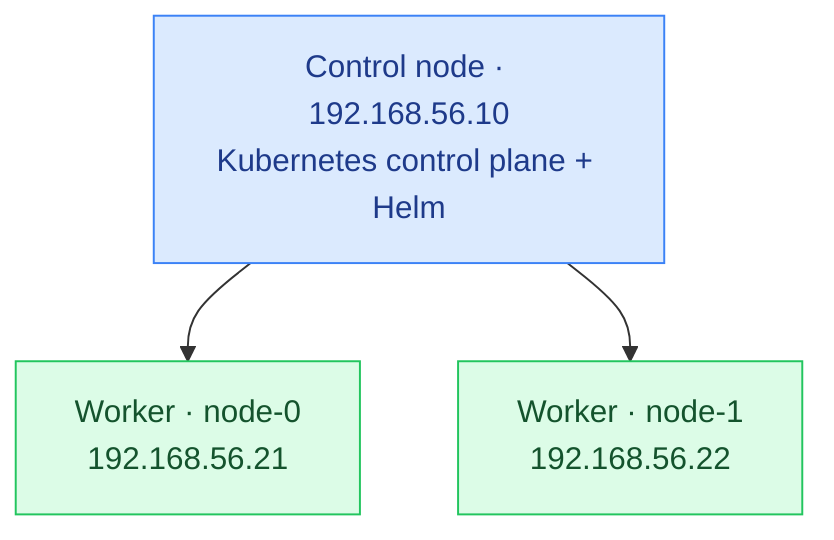

# Local Kubernetes Lab

This repository provides a quick setup for a local Kubernetes VM environment on your local network, with one control node and two worker nodes managed by Vagrant and VirtualBox.

It is intended for learning, experimenting, and practicing Kubernetes in a repeatable environment on your own computer.

## Environment

The `Vagrantfile` defines three Debian Bookworm virtual machines: one intended control node and two intended worker nodes.

| Machine | Intended role | IP address | CPUs | Memory |
| --- | --- | --- | --- | --- |
| `control-node` | Control plane | `192.168.56.10` | 2 | 2048 MB |
| `node-0` | Worker | `192.168.56.21` | 1 | 2048 MB |
| `node-1` | Worker | `192.168.56.22` | 1 | 2048 MB |

Each VM receives a hostname and entries in `/etc/hosts` for the other machines. VirtualBox names are prefixed with `k8s-`.

The control node has two CPUs and 2048 MB of RAM. Each worker has one CPU and 2048 MB of RAM.

## Cluster architecture



All three VMs share a VirtualBox private network. Helm runs on the control node, and Calico provides pod networking.

## Networking

The machines use a VirtualBox private network so your host computer and the VMs can communicate using the addresses above. This configuration does not automatically expose the VMs to other devices on your physical local network. Access from those devices requires additional network configuration, such as bridged networking or routing.

If these addresses conflict with an existing network, update both the machine definitions and the `/etc/hosts` provisioning block in `Vagrantfile`.

## Prerequisites

- Vagrant and VirtualBox installed on your computer.
- Hardware virtualization enabled.
- Enough available memory and disk space for all three VMs. The current configuration assigns 6144 MB (6 GiB) of RAM in total, in addition to your host's own requirements.
- Internet access to download the Debian box and any packages installed during provisioning.

## Automated setup

Vagrant runs `scripts/setup.sh` on all three machines after adding their host entries. The script:

- Disables swap for the current session.
- Configures the `overlay` and `br_netfilter` kernel modules to load at boot and loads them immediately.
- Enables IP forwarding and bridge traffic processing through iptables using persistent sysctl settings.
- Requires root privileges and emits timestamped status and error messages.
- Installs and restarts containerd with systemd cgroups enabled, then verifies that the service is active and the cgroup setting is applied.
- Installs `kubelet`, `kubeadm`, and `kubectl` from the Kubernetes v1.35 package repository and holds those packages against automatic upgrades.
- Sets the kubelet's node IP to the corresponding private-network address and enables the kubelet service.

On `control-node`, the script also initializes the control plane with `kubeadm` when `/etc/kubernetes/admin.conf` does not exist. It uses `192.168.56.10` as the API server's advertised address and `10.244.0.0/16` as the pod network CIDR.

It waits for the API server readiness endpoint before copying the administrator kubeconfig to `/home/vagrant/.kube/config`. It installs the Calico v3.31.4 CRDs using server-side apply, waits for the installation CRD to be established, applies the operator, and waits for its deployment rollout before applying custom resources with the same pod CIDR.

The control node writes a generated `kubeadm join` command to `/vagrant/join-command.sh`, which is shared with the host and workers through the repository directory. Workers execute this command automatically unless `/etc/kubernetes/kubelet.conf` already exists. If the shared file is missing or empty, worker provisioning fails with an error. This file contains cluster join credentials and is excluded from Git.

After control-plane setup, the script installs Helm on `control-node` only. It downloads the Helm APT signing key from the Buildkite-hosted repository, checks its fingerprint against the value pinned in `install_helm`, configures the signed APT source, and installs the `helm` package. A fingerprint mismatch stops provisioning. The Helm package version is not pinned or held, so the version installed depends on the repository at provisioning time.

## Starting the environment

Run these commands from the repository directory:

```sh
vagrant validate
vagrant up --provider=virtualbox
```

The first command checks the Vagrant configuration. The second creates and provisions the VMs; it may take longer on the first run while the base box downloads.

## Joining and checking the cluster

Workers join automatically during provisioning. Provision the control node before the workers so the shared join command is available. If starting machines individually, use this order:

```sh
vagrant up control-node --provider=virtualbox
vagrant up node-0 node-1 --provider=virtualbox
```

After provisioning, connect to the control node and check the cluster:

```sh
vagrant ssh control-node
kubectl get nodes -o wide
kubectl get pods -A
```

The `vagrant` user on the control node can run these commands using the kubeconfig installed by the setup script. Nodes may take some time to become ready while networking starts; the script waits for the API server and operator, but does not wait for every node or Calico pod to become ready.

If a worker fails because its join command is missing or expired, refresh the shared file from your host:

```sh
vagrant ssh control-node -c 'sudo kubeadm token create --print-join-command' > join-command.sh
vagrant provision node-0 node-1
```

Keep `join-command.sh` private. It is generated locally and should never be committed.

## Using Helm

Connect to the control node as the `vagrant` user and verify the installation and cluster access:

```sh
vagrant ssh control-node
helm version
kubectl cluster-info
helm list --all-namespaces
```

Helm uses `/home/vagrant/.kube/config`, which provisioning creates for the `vagrant` user. Run Helm as that user so it can use this configuration. An empty release list is expected before you install any charts; provisioning installs Helm but does not deploy charts.

To install a chart you have chosen, replace the placeholders below with its release name, chart reference, and target namespace:

```sh
helm install <release-name> <chart-reference> --namespace <namespace> --create-namespace
helm list --all-namespaces
```

## Connecting to the VMs

Use the machine name to open an SSH session:

```sh
vagrant ssh control-node
vagrant ssh node-0
vagrant ssh node-1
```

Run each command separately to connect to the corresponding VM. Use `exit` to return to your host shell.

## Managing the lab

```sh
# Show the state of all machines
vagrant status

# Stop the VMs while keeping their disks
vagrant halt

# Start existing VMs again
vagrant up

# Re-run provisioning
vagrant provision

# Delete the VMs and their data (prompts for confirmation)
vagrant destroy
```

The current hosts-file provisioner appends entries on each run, so repeated provisioning can create duplicate `/etc/hosts` entries.

The script skips control-plane initialization when `/etc/kubernetes/admin.conf` exists and skips worker joins when `/etc/kubernetes/kubelet.conf` exists. Calico resources now use `kubectl apply`. However, provisioning is not fully repeatable: the GPG key import still writes an existing file without an explicit overwrite option and may fail or prompt on subsequent runs. Each run also regenerates the containerd configuration, replacing local edits.

Swap is disabled at runtime only; the script does not change `/etc/fstab` to keep it disabled after a reboot.

## Repository layout

```text
Vagrantfile       # VM resources, addresses, and provisioning
scripts/setup.sh # Node preparation, control plane, Calico, worker joins, and Helm
join-command.sh  # Generated join credentials (ignored by Git)
README.md        # Setup and usage instructions
.gitignore       # Excludes local VM state and credentials
```
